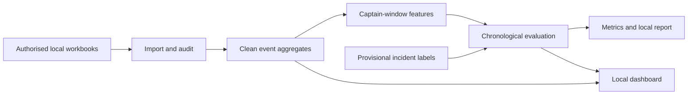

# CEG2003 Bus Captain Safety Review

A reproducible Python project that investigates whether prior driving alarms can help prioritise bus captains for preventive safety review. It includes data auditing, chronological machine-learning experiments, a local dashboard, report generation and presentation support.

**This public repository contains source code and documentation. Confidential workbooks, generated reports/results, private identity mappings, fitted models and individual predictions remain local.** Authorised course data is required to run the full analysis.

## Project components

- Streaming import of every alarm worksheet, typed Parquet caching and source SHA-256 fingerprints.
- Exact-event deduplication, timestamp/duration checks and incident-label auditing.
- Six prespecified captain-level features with explicit prediction windows.
- Logistic regression, balanced logistic regression and constrained random forest models.
- Constant-prevalence and collision-warning baselines, frozen tests and bootstrap uncertainty.
- A five-page Streamlit dashboard with shared fleet filters and captain drill-down.
- Local Markdown/PDF report, figures, walkthrough notebook and browser presentation.
- Tests, build scripts and a requirements checklist.

Read the [implementation guide](docs/REPOSITORY_GUIDE.md) for the complete building process and methodological explanation.

## Quick start on Windows

Use Python 3.11, Git and PowerShell. Run commands from the repository root.

### 1. Clone and install

```powershell
git clone https://github.com/lushiqiS7/CEG2003_project.git
cd CEG2003_project
python -m venv .venv
.\.venv\Scripts\python.exe -m pip install -r requirements.txt
```

The dependency lock records the tested Windows environment. It includes Jupyter for the walkthrough and Streamlit for the dashboard.

### 2. Add authorised data

Create `data/raw/` and place the original, unchanged course workbooks there:

```text
data/raw/
  Mar24_part1.xlsx
  Mar24_part2.xlsx
  Traffic Accident Database 2024.xlsx
```

Obtain these files through authorised course sharing. They are not included in GitHub. See [data placement instructions](data/README.md).

### 3. Build the project

```powershell
.\build_project.ps1
```

The script runs analysis, the complete test suite, report generation, support-material generation and packaging. The first import can take several minutes. Later builds reuse the source-hash-verified event cache. To force a new import:

```powershell
.\build_project.ps1 -ForceImport
```

If PowerShell script execution is restricted, run the stages directly:

```powershell
.\.venv\Scripts\python.exe run_project.py
.\.venv\Scripts\python.exe -m pytest -q --junitxml=results/test_results.xml
.\.venv\Scripts\python.exe scripts\build_report.py
.\.venv\Scripts\python.exe scripts\build_support_materials.py
.\.venv\Scripts\python.exe scripts\package_project.py
```

Packaging uses the browser presentation when no editable PowerPoint file is available. The optional PowerPoint builder requires the Codex artifact runtime; it is not required for the analysis, PDF report or HTML presentation.

### 4. Launch the dashboard

```powershell
.\launch_dashboard.ps1
```

Open [http://127.0.0.1:8501](http://127.0.0.1:8501). Alternatively:

```powershell
.\.venv\Scripts\python.exe -m streamlit run dashboard\app.py --server.address 127.0.0.1 --server.port 8501
```

The dashboard runs locally. It reads generated aggregates, so build the analysis before launching it.

## Analysis design



The primary experiment stays within March 2024:

| Stage | Alarm feature window | Subsequent recorded-outcome window |
|---|---|---|
| Training | 1-7 March | 8-14 March |
| Validation | 8-14 March | 15-21 March |
| Frozen test | 15-21 March | 22-28 March |

Each row is a captain-window. Existing captains can recur across chronological windows; identifiers never enter the model. Learned preprocessing stays inside pipelines, and validation average precision selects the ML architecture before testing. The default review capacity is 10%.

Features measure harsh manoeuvres, fatigue, collision/proximity warnings, speeding, night alarm share and observed alarm days. Observed alarm days are an exposure proxy, not working days, driving hours or kilometres. The default minimum is three observed days. Captains without enough recent history remain unscored.

A separately labelled March-to-April captain holdout is supplementary. Its permitted scope and complete follow-up require course confirmation.

The project is an exploratory prototype. Sparse outcomes, weak discrimination, incomplete exposure and unconfirmed incident meanings limit predictive claims. Recorded involvement does not establish fault. Ranking scores and percentiles are not calibrated accident probabilities.

## Dashboard pages

| Page | Purpose |
|---|---|
| Fleet overview | Date, route and category filters with consistent event/captain totals |
| Captain review | Fixed latest-window demonstration ranking and review-capacity scenarios |
| Captain detail | Daily alarm history, category composition and observed routes |
| Model evaluation | Frozen metrics, selection evidence and uncertainty |
| Data quality and requirements | Reconciliation, assumptions and remaining course deliverables |

## Repository layout

```text
dashboard/app.py                 Local Streamlit app
data/README.md                   Authorised input placement
docs/REPOSITORY_GUIDE.md          Full implementation explanation
notebooks/Project_Walkthrough.ipynb
scripts/                         Report, support, slide and package builders
src/ceg2003/data.py               Import, cleaning and aggregation
src/ceg2003/features.py           Features, labels and review capacity
src/ceg2003/model.py              Selection, tests, sensitivity and refit
src/ceg2003/outputs.py            Measured figures and report source
tests/                          Unit and integration checks
project_config.json              Declared dates, seed and settings
requirements.txt                 Tested dependency versions
run_project.py                   Analysis entry point
build_project.ps1                Full local build
launch_dashboard.ps1             Dashboard launcher
```

After building, Git-ignored local folders contain processed data, model files, evaluation results, the report, presentation materials and submission ZIPs. These files are not available by cloning this repository; rebuild them with authorised inputs.

## Tests

Pure unit tests can run without the source workbooks:

```powershell
.\.venv\Scripts\python.exe -m pytest -q -m "not data"
```

After building the data, run the complete suite:

```powershell
.\.venv\Scripts\python.exe -m pytest -q --junitxml=results/test_results.xml
```

Checks cover future-event exclusion, observed-day denominators, outcome population preservation, capacity arithmetic, source reconciliation, chronological partitions, supplemental identity separation and dashboard filtering/navigation.

## Notebook outputs

The committed notebook contains code and explanations without executed outputs. Run it after building the analysis. To keep future notebook outputs out of commits while preserving the executed working copy, configure this repository's clean filter after creating `.venv`:

```powershell
git config filter.strip-notebook.clean '".venv/Scripts/python.exe" scripts/strip_notebook_outputs.py'
git config filter.strip-notebook.smudge '".venv/Scripts/python.exe" scripts/strip_notebook_outputs.py --smudge'
git config filter.strip-notebook.required true
```

## Course deliverables

The local build generates the technical report, code package, dashboard, browser deck, speaker script and recording guide. The group must still add authorship details, confirm identity/incident definitions and scope, record each member presenting about five minutes with their face visible, complete the official peer-assessment form, and submit through the LMS. Check the current rubric and deadline year/timezone.

No real presentation video or personal contribution scores are fabricated by the build.

## References

- [scikit-learn: common pitfalls and data leakage](https://scikit-learn.org/stable/common_pitfalls.html)
- [scikit-learn: precision-recall evaluation](https://scikit-learn.org/stable/auto_examples/model_selection/plot_precision_recall.html)
- [openpyxl: optimised read-only modes](https://openpyxl.readthedocs.io/en/stable/optimized.html)

Course-specific requirements come from the supplied CEG2003 briefing, which remains outside this public repository.
